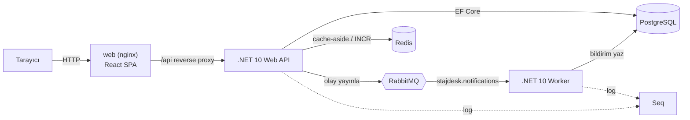
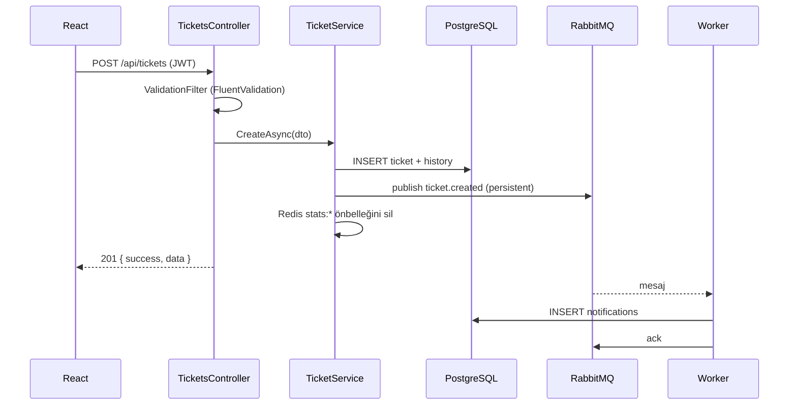
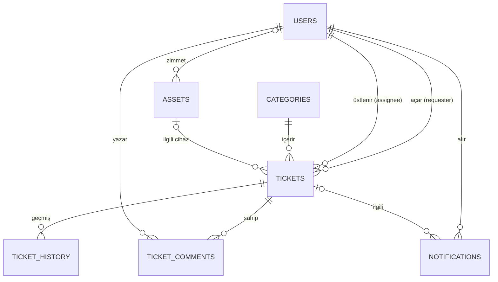

# StajDesk Mimarisi

## 1. Genel görünüm



- **Tarayıcı** yalnızca `web` konteynerini görür. nginx statik dosyaları sunar, `/api/*` isteklerini API'ye aktarır; bu sayede tek origin olur ve CORS gerekmez.
- **API** iş kurallarını uygular, kalıcı veriyi PostgreSQL'de tutar, sık okunan veriyi Redis'te önbelleğe alır ve talep olaylarını RabbitMQ'ya bırakır.
- **Worker** kuyruğu dinler, olaydan bildirim kayıtları üretir ("e-posta gönderildi" logu dahil). Worker kapalıyken gelen mesajlar kuyrukta bekler.
- **Seq** her iki servisin yapısal loglarını tek ekranda toplar (`Application` alanıyla filtrelenebilir).

## 2. Backend katmanları (Clean Architecture)

```
src/backend
├── StajDesk.Domain          Varlıklar, enum'lar, iş kuralları (Ticket.ChangeStatus ...). Dış bağımlılık yok.
├── StajDesk.Contracts       RabbitMQ mesaj sözleşmeleri (TicketCreatedEvent ...) — API ve Worker ortak kullanır.
├── StajDesk.Application     Servisler (kullanım senaryoları), DTO'lar, FluentValidation kuralları, soyutlamalar.
├── StajDesk.Infrastructure  EF Core DbContext + migration'lar, Redis, RabbitMQ yayıncısı, şifre hash.
├── StajDesk.Api             Controller'lar, JWT, global hata yönetimi, Program.cs.
├── StajDesk.Worker          RabbitMQ tüketicisi (BackgroundService) + NotificationHandler.
└── tests/StajDesk.UnitTests xUnit v3 — domain kuralları ve TicketService (EF InMemory ile).
```

Bağımlılık yönü içeri doğrudur: `Api → Infrastructure → Application → Domain`. Application, Redis veya RabbitMQ'yu
tanımaz; yalnızca `ICacheService`, `IEventPublisher`, `ILoginRateLimiter` arayüzlerini bilir. Testlerde bunların
sahte (fake) sürümleri kullanılır.

### İstek akışı (talep oluşturma)



### Yanıt zarfı

Tüm uçlar aynı biçimi döner:

```json
{ "success": false, "data": null, "message": "Gönderilen bilgilerde hata var.", "errors": { "title": ["Başlık zorunludur."] } }
```

| Hata | HTTP |
|---|---|
| Doğrulama / iş kuralı (`ValidationException`, `DomainException`) | 400 |
| Oturum yok / hatalı giriş | 401 |
| Yetki yok (`ForbiddenException`) | 403 |
| Kayıt yok | 404 |
| Çakışma (aynı e-posta, envanter no) | 409 |
| Hız sınırı | 429 (+ `Retry-After`) |
| Beklenmeyen | 500 (ayrıntı yalnızca logda) |

## 3. Veri modeli



Tablo ve sütun adları `snake_case`'tir (EFCore.NamingConventions). İndeksler:
`users.email` (unique — giriş sorgusu), `categories.name` (unique), `assets.inventory_number` (unique),
`tickets.status / requester_id / assignee_id / category_id / created_at` (filtre ve sıralama),
`notifications (user_id, is_read)` (okunmamış bildirim sayacı).

## 4. API uçları

| Metot | Yol | Yetki | Açıklama |
|---|---|---|---|
| POST | `/api/auth/register` | Anonim | Kayıt (rol: User) |
| POST | `/api/auth/login` | Anonim | Giriş → JWT. E-posta başına 5 dk'da 5 hatalı deneme |
| GET | `/api/auth/me` | Oturum | Oturumdaki kullanıcı |
| GET | `/api/tickets` | Oturum | `status, priority, type, categoryId, assigneeId, unassigned, activeOnly, search, sort, page, pageSize`. Kullanıcı yalnızca kendi taleplerini görür |
| GET | `/api/tickets/{id}` | Oturum | Detay + yorumlar + geçmiş + `allowedStatuses` |
| POST | `/api/tickets` | Oturum | Talep aç → `ticket.created` |
| PUT | `/api/tickets/{id}` | Sahip (Açık iken) / Destek | Başlık, açıklama, kategori, tür |
| PATCH | `/api/tickets/{id}/status` | Destek; sahip yalnızca Çözüldü → Kapandı/İşlemde | `ticket.status-changed` |
| PATCH | `/api/tickets/{id}/priority` | Destek | |
| PATCH | `/api/tickets/{id}/assign` | Destek | `ticket.assigned`; Açık talep → İşlemde |
| POST | `/api/tickets/{id}/comments` | Sahip / Destek | `isInternal` yalnızca destek |
| DELETE | `/api/tickets/{id}` | Yönetici | |
| GET/POST/PUT/DELETE | `/api/categories` | Okuma: oturum, yazma: Yönetici | Redis'te 60 sn önbellek |
| GET | `/api/assets`, `/api/assets/{id}` | Destek (kullanıcı: kendi zimmeti) | Envanter |
| GET | `/api/assets/mine` | Oturum | Kullanıcının zimmetli cihazları |
| POST/PUT/DELETE | `/api/assets` | Destek / silme: Yönetici | |
| GET | `/api/users`, POST, PUT `/api/users/{id}` | Yönetici | Rol ve aktiflik yönetimi |
| GET | `/api/users/agents`, `/api/users/lookup` | Destek | Atama ve zimmet listeleri |
| GET | `/api/stats` | Oturum | Özet paneli (rol kapsamlı, 60 sn önbellek) |
| GET | `/api/notifications`, `/unread-count` | Oturum | |
| PATCH/POST | `/api/notifications/{id}/read`, `/read-all` | Oturum | |
| GET | `/api/health` | Anonim | Sunucu saati, DB ve Redis durumu |

## 5. Mesajlaşma

| Öğe | Değer |
|---|---|
| Exchange | `stajdesk.events` (topic, durable) |
| Kuyruk | `stajdesk.notifications` (durable, `ticket.*` ile bağlı) |
| Ölü mektup | `stajdesk.events.dlx` → `stajdesk.notifications.dlq` |
| Mesajlar | `ticket.created`, `ticket.status-changed`, `ticket.assigned`, `ticket.comment-added` (JSON, persistent) |

Worker `autoAck: false` ile çalışır: başarılı işlemde `ack`, bozuk mesajda `nack(requeue:false)` → DLQ,
geçici hatada bir kez tekrar dener, ikinci hatada DLQ'ya gönderir. API tarafında publisher confirm açıktır;
broker erişilemezse istek başarısız olmaz, hata loglanır (iyileştirme fikri: **Outbox deseni**).

## 6. Redis kullanımı

| Anahtar | Amaç | Süre |
|---|---|---|
| `stajdesk:categories:all` | Kategori listesi (cache-aside) | 60 sn, kategori değişince silinir |
| `stajdesk:stats:staff`, `stajdesk:stats:user:{id}` | Özet paneli | 60 sn, talep değişince `stats:*` silinir |
| `stajdesk:login-fail:{email}` | Başarısız giriş sayacı (`INCR` + `EXPIRE`) | 5 dk |

Redis kapalıysa uygulama durmaz (fail-open): önbellek atlanır, veritabanından okunur, uyarı loglanır.

## 7. Frontend

```
src/frontend/src
├── lib/         api.ts (axios + interceptor'lar), types.ts, labels.ts (TR etiketler + renk sınıfları), format.ts
├── stores/      auth.ts (zustand + localStorage), ui.ts (tema, mobil menü, toast)
├── components/  ui.tsx (Badge, Modal, Pagination, durum ekranları…), layout/ (Sidebar, Header, AppLayout)
└── pages/       Auth, Dashboard, Tickets, TicketDetail, NewTicket, Assets, AssetDetail, Categories, Users, Notifications
```

- Sunucu verisi **TanStack Query** ile (önbellek, yeniden deneme, polling); oturum **zustand** ile.
- Her isteğe JWT axios interceptor'ı ile eklenir; 401'de oturum kapatılıp girişe yönlendirilir.
- Route guard (`RequireAuth`) yalnızca kullanıcı deneyimi içindir; asıl yetki kontrolü API'dedir.
- Tasarım dili Mosaic Lite'tan esinlenmiştir: açık/koyu tema, menekşe vurgu, kart tabanlı düzen, Inter yazı tipi.

## 8. Güvenlik kontrol listesi

- [x] Şifreler PBKDF2 (ASP.NET Core Identity hasher) ile salt'lı hash olarak saklanır
- [x] Gizli değerler koda değil `.env` / ortam değişkenlerine yazılır; `.env` depoda yok
- [x] Tüm uçlarda `[Authorize]` varsayılan, anonim uçlar açıkça işaretli
- [x] Tüm istek DTO'larında sunucu tarafı doğrulama
- [x] Kullanıcı başkasının talebini göremez/değiştiremez (servis katmanında kontrol + testler)
- [x] Brute-force koruması (Redis) + IP başına genel hız sınırı (ASP.NET RateLimiter)
- [x] Loglara şifre/token yazılmaz; 500 hatalarında iç ayrıntı kullanıcıya gösterilmez
