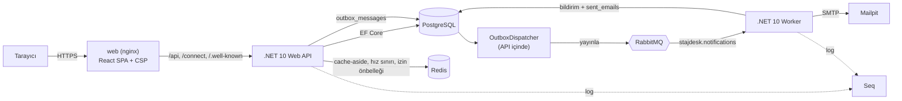
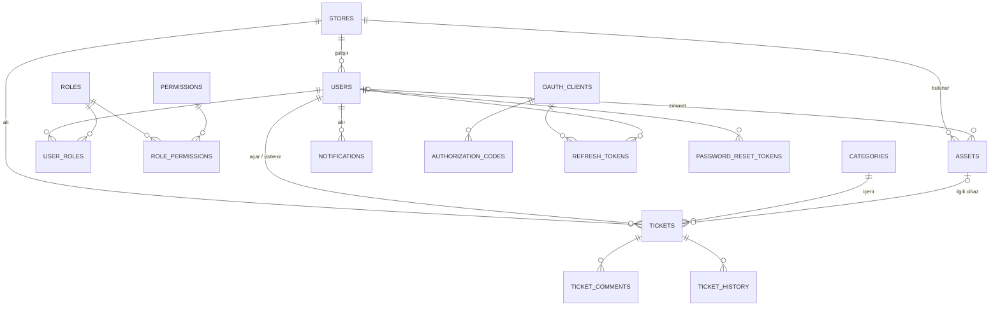

# StajDesk Mimarisi

## 1. Genel görünüm



- Tarayıcı yalnızca `web` konteynerini görür. nginx statik dosyaları sunar; `/api`, `/connect` ve `/.well-known` isteklerini API'ye aktarır. Tek origin olduğu için refresh cookie `SameSite=Strict` ile çalışır.
- API iş kurallarını uygular. Olayları aynı transaction içinde `outbox_messages` tablosuna yazar; arka plandaki `OutboxDispatcher` bunları RabbitMQ'ya taşır.
- Worker kuyruğu dinler. Uygulama içi bildirim üretir ve e-postayı Mailpit'e SMTP ile gönderir. Aynı mesajı iki kez işlemez (`processed_messages`).
- Seq her iki servisin yapısal loglarını toplar (`Application` alanıyla filtrelenebilir).

## 2. Backend katmanları (Clean Architecture)

```
src/backend
├── StajDesk.Domain          Varlıklar, enum'lar, iş kuralları (Ticket.ChangeStatus …), izin ve rol tanımları. Bağımlılık yok.
├── StajDesk.Contracts       RabbitMQ mesaj sözleşmeleri ve routing key'ler — API ve Worker ortak kullanır.
├── StajDesk.Application     Kullanım senaryoları: CQRS handler'ları (Tickets), servisler, DTO'lar, doğrulayıcılar, soyutlamalar.
├── StajDesk.Infrastructure  EF Core + migration'lar, seed, Redis, RabbitMQ + outbox, şifre hash, denetim kaydı.
├── StajDesk.Api             Controller'lar, OAuth uçları, JWT doğrulama, izin middleware'i, hata yönetimi, güvenlik başlıkları.
├── StajDesk.Worker          RabbitMQ tüketicisi, NotificationHandler, MailKit ile e-posta.
└── tests/StajDesk.UnitTests xUnit — domain kuralları, CQRS handler'ları, rol görünürlüğü, PKCE, XSS reddi.
```

Bağımlılık yönü içeri doğrudur: `Api → Infrastructure → Application → Domain`. Application, Redis'i, RabbitMQ'yu ve
JWT kütüphanesini tanımaz; yalnızca `ICacheService`, `IRateLimiter`, `IEventPublisher`, `IAccessTokenIssuer`,
`ICurrentUser`, `IAuditLogger` arayüzlerini bilir. Testlerde bunların sahte sürümleri kullanılır.

### SOLID'in projedeki karşılığı

| İlke | Nerede? |
|---|---|
| Tek sorumluluk | Her CQRS handler tek bir işi yapar (`AssignTicketHandler`, `ChangeTicketStatusHandler` …) |
| Açık/kapalı | Yeni rol eklemek kod değişikliği istemez; kod izne bakar, rol adına değil |
| Liskov | `ICacheService` için Redis ve test sahtesi birbirinin yerine geçer |
| Arayüz ayrımı | `IRateLimiter`, `IEventPublisher`, `IUnitOfWork` küçük ve tek amaçlı |
| Bağımlılığın ters çevrilmesi | Application soyutlamaları tanımlar, Infrastructure uygular |

### CQRS (hafif, kütüphanesiz)

Talepler modülü komut ve sorgu olarak ayrılmıştır. Diğer modüller (kategori, envanter…) basit CRUD olduğu için uygulama servisi olarak kaldı (bkz. [DECISIONS.md](DECISIONS.md)).

```
IDispatcher.Send(request)
  → IValidator<TRequest> (varsa, FluentValidation)
  → IRequestHandler<TRequest, TResponse>.Handle
```

| Komutlar | Sorgular |
|---|---|
| `CreateTicket`, `UpdateTicket`, `ChangeTicketStatus`, `ChangeTicketPriority`, `AssignTicket`, `AddComment`, `DeleteTicket` | `ListTickets`, `GetTicket` |

Komutlar `IUnitOfWork` ile tek transaction'da hem veriyi hem outbox mesajını yazar. Sorgular `AsNoTracking` ile okur ve
kullanıcının görebileceği kapsamla (`TicketAccess`) filtrelenir.

### İstek akışı (talep oluşturma)

```mermaid
sequenceDiagram
    participant UI as React
    participant API as TicketsController
    participant MW as PermissionLoadingMiddleware
    participant H as CreateTicketHandler
    participant DB as PostgreSQL
    participant OD as OutboxDispatcher
    participant MQ as RabbitMQ
    participant WK as Worker
    UI->>API: POST /api/tickets (Bearer at+jwt)
    API->>MW: izinleri Redis'ten / DB'den yükle
    API->>H: Dispatcher.Send(CreateTicket)
    H->>DB: BEGIN; INSERT ticket, history, outbox_messages; COMMIT
    API-->>UI: 201 { success, data }
    OD->>DB: SELECT … FOR UPDATE SKIP LOCKED
    OD->>MQ: publish ticket.created (confirm)
    OD->>DB: processed_at = now()
    MQ-->>WK: mesaj
    WK->>DB: notifications + sent_emails (idempotent)
    WK->>WK: SMTP → Mailpit
```

### Yanıt zarfı

```json
{ "success": false, "data": null, "message": "Gönderilen bilgilerde hata var.", "errors": { "title": ["Başlık zorunludur."] } }
```

OAuth uçları (`/connect/*`) RFC 6749 biçiminde döner: `{ "error": "invalid_grant", "error_description": "…" }`.

| Hata | HTTP |
|---|---|
| Doğrulama / iş kuralı | 400 |
| Oturum yok / token geçersiz | 401 |
| İzin yok veya kayıt kapsam dışı | 403 |
| Kayıt yok | 404 |
| Çakışma (aynı e-posta, envanter no, mağaza kodu) | 409 |
| Hız sınırı | 429 (+ `Retry-After`) |
| Beklenmeyen | 500 (ayrıntı yalnızca Seq'te) |

## 3. Veri modeli



Sistem tabloları: `outbox_messages`, `processed_messages`, `sent_emails`, `audit_logs`.
Panel tabloları: `announcements` (isteğe bağlı mağaza hedefi), `on_call_shifts` (tarih aralığı CHECK kısıtı), `ticket_attachments` (talep silinince CASCADE).
`tickets.search_vector` tam metin arama için hesaplanan sütundur (GIN index). Ayrıntı: [PANEL.md](PANEL.md).

Veri bütünlüğü kuralları:

- Tablo ve sütun adları `snake_case` (EFCore.NamingConventions).
- Unique: `users.email`, `roles.name`, `permissions.key`, `stores.code`, `categories.name`, `assets.inventory_number`, `refresh_tokens.token_hash`, `authorization_codes.code_hash`.
- Silme davranışı bilinçli seçildi:
  - Talep silinince yorumları, geçmişi ve bildirimleri `CASCADE` ile gider.
  - Talebi açan kullanıcı ve kategori `RESTRICT`: talebi olan kullanıcı/kategori silinemez (kullanıcı pasifleştirilir).
  - Atanan kişi, cihaz ve mağaza `SET NULL`: silinse bile talep kaybolmaz.
  - Rol–izin ve kullanıcı–rol bağlantıları `CASCADE`.
- Token'lar (refresh, authorization code, şifre sıfırlama) veritabanında yalnızca SHA-256 hash olarak tutulur.
- Enum'lar metin olarak saklanır; sıralı değişikliklerde eski veriler bozulmaz.

## 4. API uçları

| Metot | Yol | Gerekli izin | Açıklama |
|---|---|---|---|
| POST | `/connect/authorize` | Anonim | E-posta + şifre + PKCE `code_challenge` → yetki kodu |
| POST | `/connect/token` | Anonim / istemci | `authorization_code`, `refresh_token`, `client_credentials` |
| POST | `/connect/revoke` | Anonim | Refresh token iptali (RFC 7009) |
| GET | `/.well-known/oauth-authorization-server` | Anonim | Sunucu metadata (RFC 8414) |
| GET | `/.well-known/jwks.json` | Anonim | İmza doğrulama anahtarı |
| POST | `/api/auth/register` | Anonim | Kayıt (rol: Kullanıcı) |
| POST | `/api/auth/forgot-password`, `/reset-password` | Anonim | Şifre sıfırlama (e-posta ile, 30 dk) |
| GET | `/api/auth/me` | Oturum | Kullanıcı, roller, izinler, mağaza |
| GET | `/api/tickets`, `/api/tickets/{id}` | Oturum | Kapsam: kendi / mağaza / tümü |
| POST | `/api/tickets` | `tickets.create` | |
| PUT | `/api/tickets/{id}` | `tickets.update.own` veya `tickets.manage` | |
| PATCH | `/api/tickets/{id}/status` | `tickets.manage` (sahip: çözümü onaylama) | |
| PATCH | `/api/tickets/{id}/priority`, `/assign` | `tickets.manage` | |
| POST | `/api/tickets/{id}/comments` | `comments.create` (`isInternal` → `comments.internal`) | |
| DELETE | `/api/tickets/{id}` | `tickets.delete` | |
| GET / POST / PUT / DELETE | `/api/categories` | okuma: oturum, yazma: `categories.manage` | |
| GET | `/api/assets`, `/api/assets/mine`, `/api/assets/{id}` | `assets.read.*` | |
| POST / PUT / DELETE | `/api/assets` | `assets.manage` | |
| GET | `/api/users` | `users.read` veya `users.manage` | Mağaza sahibi yalnızca kendi mağazası |
| POST / PUT | `/api/users` | `users.manage` | Roller, mağaza, aktiflik |
| GET / POST / PUT | `/api/stores` | `stores.read` / `stores.manage` | |
| GET | `/api/roles` | `users.manage` veya `roles.manage` | Rol × izin matrisi |
| PUT | `/api/roles/{id}/permissions` | `roles.manage` | |
| GET | `/api/system/audit` | `audit.read` | Denetim kayıtları |
| GET | `/api/system/emails` | `mail.read` | Gönderilen e-postalar |
| GET | `/api/stats` | Oturum | Kapsam: `all` / `store` / `user` |
| GET / PATCH / POST | `/api/notifications…` | Oturum | |
| POST | `/api/tickets/{id}/attachments` | Talebi görebilen + `comments.create` | Dosya ekle (multipart, 5 MB) |
| GET / DELETE | `/api/tickets/{id}/attachments/{aid}` | Görünürlük / yükleyen veya destek | İndir / sil |
| GET | `/api/home` | Oturum | Kişiye özel ana sayfa paneli |
| GET | `/api/announcements` | Oturum | Yayındaki duyurular (`?all=true` yönetici) |
| POST / PUT / DELETE | `/api/announcements` | `announcements.manage` | |
| GET | `/api/oncall` | Oturum | Nöbet çizelgesi |
| POST / DELETE | `/api/oncall` | `oncall.manage` | |
| WS | `/hubs/notifications` | Oturum | SignalR anlık bildirim |
| GET | `/api/health` | Anonim | DB ve Redis durumu |

## 5. Mesajlaşma

| Öğe | Değer |
|---|---|
| Exchange | `stajdesk.events` (topic, durable) |
| Kuyruk | `stajdesk.notifications` (`ticket.*` ve `user.*` ile bağlı) |
| Ölü mektup | `stajdesk.events.dlx` → `stajdesk.notifications.dlq` |
| Mesajlar | `ticket.created`, `ticket.status-changed`, `ticket.assigned`, `ticket.comment-added`, `user.registered`, `user.password-reset-requested` |

- **Outbox:** olay, iş verisiyle aynı transaction'da yazılır. Broker kapalıyken bile olay kaybolmaz; broker açılınca gönderilir.
- **Gönderim:** `OutboxDispatcher` satırları `FOR UPDATE SKIP LOCKED` ile alır (birden çok API kopyası çakışmaz) ve publisher confirm bekler.
- **Tüketim:** Worker `autoAck: false` ile çalışır. Mesaj kimliği `processed_messages` tablosuna yazılır; aynı mesaj ikinci kez gelirse atlanır (idempotent). Bozuk mesaj DLQ'ya gider.

## 6. Redis kullanımı

| Anahtar | Amaç | Süre |
|---|---|---|
| `stajdesk:categories:all` | Kategori listesi (cache-aside) | 60 sn, değişince silinir |
| `stajdesk:stats:*` | Özet paneli (kapsama göre) | 60 sn, talep değişince silinir |
| `stajdesk:perms:user:{id}` | Kullanıcının izinleri ve aktifliği | 5 dk, rol/kullanıcı değişince silinir |
| `stajdesk:rl:login:{email}`, `rl:login-ip:{ip}` | Başarısız giriş sayacı | 5 dk |
| `stajdesk:rl:reset:{email}` | Şifre sıfırlama isteği sınırı | 5 dk |

Redis kapalıysa uygulama durmaz (fail-open): önbellek atlanır, veritabanından okunur, uyarı loglanır.

## 7. Frontend

```
src/frontend/src
├── lib/         api.ts (axios, 401 → refresh → tekrar dene), oauth.ts (PKCE), types.ts, labels.ts, format.ts
├── stores/      auth.ts (access token yalnızca bellekte, useCan / useRole), ui.ts
├── components/  ui.tsx, list.tsx, layout/ (Sidebar izinlere göre, Header, AppLayout + RequireAuth)
└── pages/       Auth, Dashboard, Tickets, TicketDetail, NewTicket, Assets, Stores, Users, Roles, Categories, System (Audit, Emails)
```

- Sunucu verisi TanStack Query ile, oturum zustand ile tutulur.
- Menü ve butonlar **izinlere** göre çizilir (`useCan('tickets.manage')`). Talep detayındaki butonlar sunucunun döndüğü `permissions` alanına göre gösterilir.
- Route guard yalnızca kullanıcı deneyimi içindir; asıl yetki kontrolü API'dedir.
- Tasarım dili Mosaic Lite'tan esinlenmiştir: açık/koyu tema, menekşe vurgu, kart tabanlı düzen.
