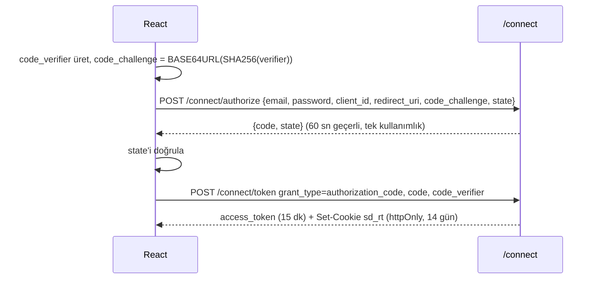

# Kimlik Doğrulama (OAuth 2.0)

StajDesk kendi yetkilendirme sunucusunu barındırır. Akışlar OAuth 2.0 ve güncel güvenlik önerilerine (OAuth 2.1 taslağı, RFC 9700) uyar:
implicit ve password grant **yoktur**, PKCE zorunludur.

| Standart | Karşılığı |
|---|---|
| RFC 6749 | `authorization_code`, `refresh_token`, `client_credentials` grant'ları |
| RFC 7636 | PKCE — yalnızca `S256` kabul edilir |
| RFC 7009 | `POST /connect/revoke` |
| RFC 8414 | `GET /.well-known/oauth-authorization-server` |
| RFC 7517 | `GET /.well-known/jwks.json` |
| RFC 9068 | Access token `typ: at+jwt`, RS256 imzalı |

## İstemciler

| client_id | Tür | Grant'lar | Not |
|---|---|---|---|
| `stajdesk-web` | Public (gizli anahtarı yok), first-party | authorization_code + refresh_token | Redirect URI'leri `OAuth:WebRedirectUris` ile tam eşleşmeli |
| `stajdesk-reporting` | Confidential | client_credentials | Servisten servise erişim örneği; scope = izin anahtarları |

## Tarayıcı girişi (Authorization Code + PKCE)



- **Access token** yalnızca JavaScript belleğinde tutulur; `localStorage`'a yazılmaz. XSS olsa bile kalıcı token çalınamaz.
- **Refresh token** `sd_rt` cookie'sindedir: `HttpOnly`, `SameSite=Strict`, `Path=/connect`, üretimde `Secure`. JS okuyamaz; yalnızca `/connect` uçlarına gider.
- Sayfa yenilenince uygulama `POST /connect/token grant_type=refresh_token` ile sessizce yeni access token alır.
- API 401 dönerse axios interceptor'ı bir kez refresh dener, başarısızsa girişe yönlendirir.

## Refresh token rotasyonu ve yeniden kullanım tespiti

Her refresh isteğinde eski token iptal edilir, aynı "aile"den yenisi verilir. İptal edilmiş bir token tekrar gelirse
bu çalınma belirtisidir: **ailenin tamamı** iptal edilir, kullanıcı yeniden giriş yapmak zorunda kalır ve
`auth.refresh_reuse_detected` denetim kaydı yazılır.

## Access token içeriği

```json
{
  "iss": "http://localhost:5080", "aud": "stajdesk-api", "typ": "at+jwt",
  "jti": "…", "sid": "…", "sub": "4", "client_id": "stajdesk-web", "name": "Selin Aydın",
  "role": "store_owner", "scope": "openid profile api", "exp": 1794094500
}
```

Payload base64 ile herkes tarafından okunabilir; bu yüzden içine gizli bilgi konmaz. İzinler ve mağaza token'a **gömülmez**. `PermissionLoadingMiddleware` her istekte kullanıcının izinlerini Redis'ten (yoksa DB'den) yükler.
Böylece rol değişikliği veya hesabın pasifleştirilmesi token süresini beklemeden anında etkili olur.

İmza anahtarı ilk açılışta üretilir ve `Jwt:KeysDirectory` içinde `jwt-signing-key.pem` olarak saklanır (Docker'da `apikeys` volume'u).
Anahtar depoya girmez.

## Servisten servise (client_credentials)

```bash
curl -s -X POST http://localhost:5080/connect/token -d grant_type=client_credentials -d client_id=stajdesk-reporting -d client_secret=Reporting!Dev2026 -d scope=reports.read.all
```

Dönen token'ın izinleri yalnızca istenen ve istemciye tanımlı scope'lardır. İstemci gizli anahtarı veritabanında hash'lenmiş saklanır.

## Şifre kuralları ve kurtarma

- En az 10 karakter, büyük harf, küçük harf ve rakam içermeli (`PasswordRule`).
- Şifreler PBKDF2 (ASP.NET Core Identity hasher) ile saklanır.
- **Şifremi unuttum:** yanıt her zaman aynıdır (e-posta var mı yok mu belli olmaz). Token 30 dk geçerli, tek kullanımlık, DB'de hash'li.
  Şifre değişince kullanıcının tüm refresh token'ları iptal edilir.

## Kaba kuvvet koruması

Sayaçlar Redis'te `stajdesk:rl:{anahtar}` altında tutulur. Eşik ve pencere `LoginRateLimit` ayarıyla değişir (varsayılan 5 / 300 sn).

| Sayaç | Varsayılan |
|---|---|
| `login:{email}` — e-posta başına hatalı giriş | 5 deneme / 5 dk → 429 + `Retry-After` |
| `login-ip:{ip}` — IP başına hatalı giriş | 5 deneme / 5 dk |
| `reset:{email}` — şifre sıfırlama isteği | 5 istek / 5 dk |

Redis erişilemezse sınırlayıcı açık kalır (fail-open) ve uyarı loglanır; uygulama çalışmaya devam eder.
