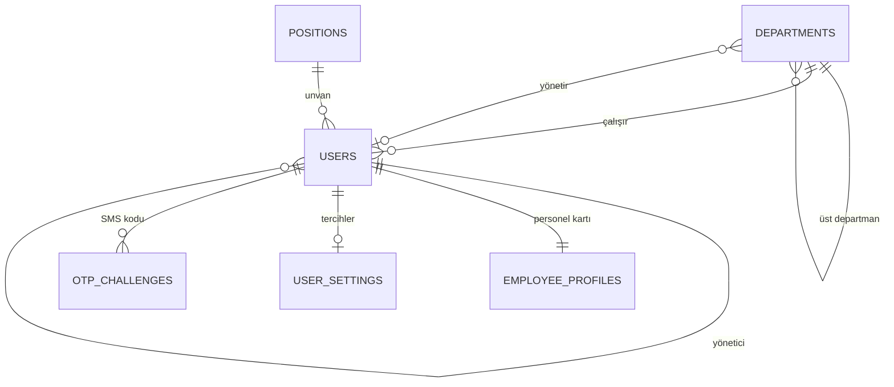

# Kimlik ve Organizasyon (Aşama 3)

## 1. Kavramlar: unvan ≠ rol

| Kavram | Nerede tutulur | Ne belirler | Kim değiştirir |
|---|---|---|---|
| **Departman** | `departments` (ağaç: üst departman, yönetici) | Organizasyon yapısı, onay zincirinde "departman yöneticisi" | `org.manage` |
| **Unvan** | `positions` (seviye 1 = en üst) | Kişinin kurumdaki adı: Müdür, Uzman, Stajyer… | `org.manage` (liste), İK (atama) |
| **Yönetici** | `users.manager_id` | Organizasyon şeması, ileride onay zincirleri | İK |
| **Sistem rolü** | `user_roles` → `role_permissions` | Sistemde **ne yapabileceği** | `users.manage` (sistem yöneticisi) |

"Müdür" unvanlı biri sistemde yalnızca "Kullanıcı" rolünde olabilir; yetkiyi unvan değil rol verir.
Promptun örnek hiyerarşisindeki "Super Admin / Admin" birer **rol**dür, unvan listesinde yer almaz.

## 2. İnsan Kaynakları rolü

`hr` (İK Personeli) rolü yalnızca personel yönetimi verir:

| Yapabilir | Yapamaz |
|---|---|
| Personel kaydı oluşturmak (davet e-postasıyla) | Sistem rolü / izin vermek (`users.manage`, `roles.manage`) |
| Departman, unvan, yönetici, mağaza, işe giriş/çıkış, çalışma türü, personel no | Departman ağacını ve unvan listesini düzenlemek (`org.manage`) |
| Hesabı aktif/pasif yapmak (pasifte oturumlar anında kapanır) | Talepleri yönetmek, denetim kaydı görmek |
| Kişisel bilgileri görmek ve düzeltmek | İzin / masraf onaylamak (ilgili modüller ayrı izin isteyecek) |

## 3. Kim neyi görür?

| Alan | Herkes | Kişinin kendisi | İK (`employees.read.private`) |
|---|---|---|---|
| Ad, unvan, departman, yönetici, iş e-postası, telefon, işe başlama, kıdem | ✔ | ✔ | ✔ |
| Doğum günü (gün-ay) | ✔ | ✔ | ✔ |
| Doğum tarihi (yıl dahil), adres, kişisel e-posta, acil durum kişisi, personel no | | ✔ | ✔ |
| Kullanıcı adı, son giriş, sistem rolleri | | ✔ | ✔ |

Yetkisiz kişiye özel alanlar API'den **hiç dönmez** (`private: null`); arayüzde gizlemek yeterli sayılmaz.
Kişisel bilgi değişiklikleri denetim kaydına yazılır ama **değerleri** yazılmaz.

## 4. Hesap akışları

| Akış | Nasıl çalışır |
|---|---|
| Giriş | Kullanıcı adı **veya** e-posta + şifre (`@` içeriyorsa e-posta) |
| Kendi kaydı | Kayıt → doğrulama e-postası (24 saat) → doğrulanmadan giriş yok (`email_not_verified`) |
| İK / yönetici hesabı açar | Şifre girilmez → "ilk şifreni belirle" daveti (72 saat, tek kullanımlık) → şifre belirlenince e-posta doğrulanmış sayılır |
| Şifre değiştirme | Profil → Hesap ve güvenlik (mevcut şifre gerekir) |
| Şifre sıfırlama | Giriş ekranı → Şifremi unuttum (30 dk) |
| SMS ile iki adımlı doğrulama | Aşağıya bakın |

Tüm bağlantı türleri tek tabloda (`password_reset_tokens.purpose`) yalnızca SHA-256 özetiyle saklanır;
bir türün bağlantısı başka iş için kullanılamaz (doğrulama bağlantısıyla şifre sıfırlanamaz).

Bu sürümden önce açılmış hesaplar migration'da doğrulanmış sayıldı; mevcut kullanıcıların girişi etkilenmedi.

## 5. SMS ile iki adımlı doğrulama

- Kod: 6 hane, 5 dakika, en fazla 5 deneme; veritabanında yalnızca özet.
- Kullanıcı açmak için telefonuna gelen kodu doğrular (telefon sahipliği kanıtlanır); kapatmak için şifresini girer.
- Giriş: şifre doğruysa API yetki kodu yerine `{ otpRequired: true, challengeId, maskedPhone }` döner;
  `POST /connect/authorize/otp` ile kod doğrulanınca yetki kodu verilir.

**SMS sağlayıcısı:** şu an **bağlı değil** (`NotConfiguredSmsSender`). Bu durumda:
- Profilde "SMS servisi yapılandırılmadı" yazar, iki adımlı doğrulama açılamaz.
- Hiçbir ekranda "SMS gönderildi" denmez.

Sağlayıcı bağlamak için `ISmsSender`'ı uygulayan bir sınıf (ör. Netgsm, İleti Merkezi HTTP API'si) yazılıp
`StajDesk.Infrastructure/DependencyInjection.cs` içinde `NotConfiguredSmsSender` yerine kaydedilir; API bilgileri `Sms__*` ortam değişkenlerinden okunur.

## 6. Veri modeli

Kısıtlar: departman kodu ve unvan adı tekil; personel no tekil (boş olabilir); kullanıcı adı tekil (boş olabilir);
departman kendisinin üstü olamaz, kullanıcı kendisinin yöneticisi olamaz (CHECK) ve zincirde döngü oluşturamaz (uygulama kuralı);
çıkış tarihi işe girişten önce olamaz (CHECK); alt departmanı veya çalışanı olan departman, kullanılan unvan silinemez.

Migration, eski serbest metin `users.department` değerlerini `departments` tablosuna taşıyıp kullanıcıları bağladı; veri kaybolmadı.

## 7. API

| Metot | Yol | İzin |
|---|---|---|
| GET | `/api/employees?search=&departmentId=&includeInactive=` | Oturum (pasifleri yalnızca İK) |
| GET | `/api/employees/{id}` | Oturum (alan bazlı gizlilik) |
| POST | `/api/employees` | `employees.manage` |
| PUT | `/api/employees/{id}/personal` | Kendisi veya `employees.manage` |
| PUT | `/api/employees/{id}/work` | `employees.manage` |
| POST | `/api/employees/{id}/invite` | `employees.manage` / `users.manage` |
| GET / PUT / DELETE | `/api/employees/{id}/photo` · `/cover` | Okuma: oturum · Değişiklik: kendisi veya İK (PNG/JPG/WEBP, 2 MB, imza kontrolü) |
| GET | `/api/org/chart`, `/api/org/departments`, `/api/org/positions` | Oturum |
| POST / PUT / DELETE | `/api/org/departments`, `/api/org/positions` | `org.manage` |
| GET / PUT | `/api/me/settings` | Oturum |
| PUT | `/api/me/password` | Oturum |
| GET | `/api/me/security` | Oturum |
| POST | `/api/me/2fa/start` · `/confirm` · `/disable` | Oturum |
| POST | `/api/auth/verify-email` · `/resend-verification` | Anonim (hız sınırlı) |
| POST | `/connect/authorize/otp` | Anonim (hız sınırlı) |

## 8. Ekranlar

| Ekran | Yol |
|---|---|
| Çalışanlar (rehber, İK için "Personel ekle") | `/employees` |
| Profil: Genel bakış · Kişisel bilgiler · İş bilgileri · Hesap ve güvenlik · Bildirim tercihleri | `/employees/{id}`, `/profile` |
| Organizasyon şeması (departman ağacı + yönetici ağacı) | `/org` |
| Departmanlar ve unvanlar | `/admin/org` |
| E-posta doğrulama · İlk şifre belirleme | `/verify-email`, `/set-password` |

## 9. Bu aşamada bilerek yapılmayanlar

| Konu | Neden / ne zaman |
|---|---|
| İzin bakiyesi sekmesi | İzin modülü Aşama 6'da; boş sekme gösterilmedi |
| Dil seçimi (TR/EN) | Ayar kaydı backend'de hazır; arayüz çevirisi Aşama 5'te. Çalışmayan bir seçenek gösterilmedi |
| Duyuru e-postası tercihi | Duyurular henüz e-posta göndermiyor; işlevsiz anahtar gösterilmedi |
| Gerçek SMS sağlayıcısı | Hesap bilgisi gerekiyor (bkz. §5) |
