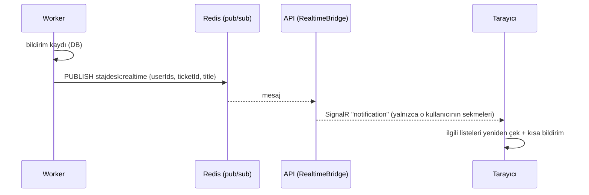

# Ana Sayfa Paneli ve Bonus Özellikler

Bu doküman PDF'in "Bonus Görevler" listesinden tamamlananları ve portal tarzı ana sayfayı anlatır.

| Bonus görev (PDF s. 22) | Durum |
|---|---|
| Talebe dosya eki yükleme (boyut ve tür sınırlamasıyla) | ✔ |
| SignalR ile gerçek zamanlı bildirim | ✔ |
| MailHog ile Worker'dan gerçek test e-postası | ✔ (MailHog'un bakımı süren karşılığı Mailpit) |
| Talep başlığı ve açıklamasında arama (PostgreSQL tam metin) | ✔ |
| Talebe öncelik alanı ve öncelik bazlı sıralama | ✔ |
| Açık/koyu tema | ✔ |

## 1. Ana sayfa (portal düzeni)

`GET /api/home` tek istekte kişiye özel paneli döner; grafikler `GET /api/stats`'tan gelir.

| Sıra | Kutucuklar |
|---|---|
| 1 | Karşılama (rol, mağaza, onay bekleyen sayısı) · Duyurular · BT nöbetçi personel |
| 2 | Birlikte geçen süre · Açık · İşlemde · Beklemede · Çözüldü · Atanmamış / Cihazlarım |
| 3 | Onayımı bekleyenler (tek tıkla "Onayla ve kapat") · Görevlerim / Son taleplerim · Son hareketler |
| 4 | Çalışan ara (yetkiliyse) · Son 14 gün grafiği |
| 5 | Durum dağılımı · Kategori / mağaza grafiği · Öncelik ve ekip iş yükü |

Izgara 12 sütunludur: geniş ekranda 3, tablette 2, telefonda 1 kutu yan yana. Hiçbir kutu sayfayı yatay kaydırmaz
(375 px'te 12 sayfa otomatik kontrol edildi).

## 2. Duyurular — `/announcements`

- Herkes okur; `announcements.manage` izni olan yayınlar, düzenler, siler.
- Önem: Bilgi / Önemli / Acil. "Sabitle" en üste alır.
- Yayın ve bitiş zamanı: ileri tarihli duyuru zamanı gelince görünür, süresi dolan kendiliğinden kalkar.
- Mağazaya özel duyuru yalnızca o mağazadaki kullanıcılara görünür.

## 3. Nöbet çizelgesi — `/oncall`

- Mesai dışı acil durumlarda aranacak bilgi işlem personeli.
- `oncall.manage` (varsayılan: Destek Personeli, Sistem Yöneticisi) ekler/siler.
- Kurallar: yalnızca destek ekibinden biri nöbete yazılabilir; aynı kişinin tarihleri çakışamaz; nöbet en fazla 31 gün.
- "Bugün" şirket saat dilimine (Europe/Istanbul) göre hesaplanır; Docker UTC çalışsa da gece yarısı kayması olmaz.

## 4. Talep ekleri

| Kural | Değer |
|---|---|
| Boyut | En fazla 5 MB (nginx 6 MB'ta keser, API 5 MB'ı kontrol eder) |
| Sayı | Talep başına en fazla 10 |
| Türler | png, jpg, gif, webp, pdf, txt, log, csv, docx, xlsx |
| İçerik kontrolü | Dosyanın ilk baytları uzantıyla eşleşmeli (`.png` adlı bir `.exe` reddedilir) |
| Saklama | Docker `uploads` volume'u; diskteki ad rastgele 32 haneli anahtar |
| İndirme | Yetki kontrolü + her zaman `Content-Disposition: attachment` + `CSP: sandbox` |
| Silme | Yükleyen (talep kapanmadıysa) veya destek ekibi |

Her yükleme/silme talep geçmişine ve denetim kaydına yazılır.

## 5. Anlık bildirimler (SignalR)

- Hub: `/hubs/notifications`, `[Authorize]`; kullanıcı eşlemesi JWT `sub` ile.
- WebSocket başlık taşıyamadığı için token yalnızca `/hubs` yolunda sorgu parametresiyle kabul edilir; nginx bu yolda erişim logunu kapatır.
- Mesajda veri yoktur, yalnızca "yenile" sinyali vardır; asıl veri her zaman yetki kontrollü API'den okunur.
- Bağlantı koparsa otomatik yeniden bağlanır; bu sırada 15 sn'lik yoklama (polling) yedek yol olarak çalışır.
  Üst çubuktaki nokta durumu gösterir: yeşil = canlı, sarı = bağlanıyor, gri = yoklama.

## 6. Tam metin arama

- `tickets.search_vector` = `to_tsvector('turkish', başlık || açıklama)` — veritabanında hesaplanan (STORED) sütun + GIN index.
- Sorgu: `websearch_to_tsquery('turkish', …)` → "yazıcılar" araması "Yazıcı" içeren talebi bulur; `"tırnaklı ifade"` ve `-hariç` desteklenir.
- Kelimenin bir parçası yazılırsa başlıkta `ILIKE` ile de eşleşir; `#42` doğrudan talep numarasıdır.
- Uygulama katmanı yalnızca `ITicketSearch` arayüzünü bilir; testlerde basit "içerir" araması kullanılır.
